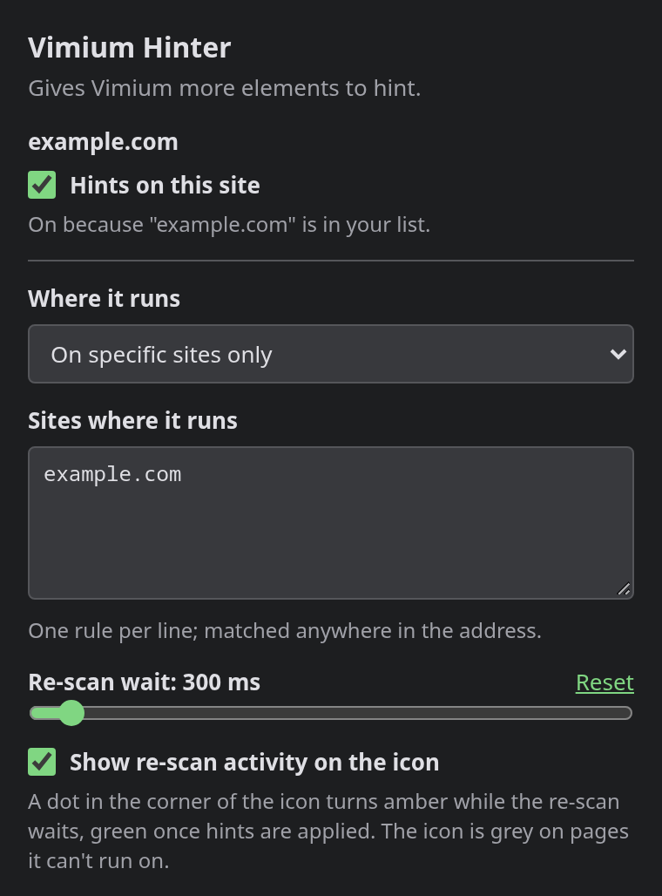

# Vimium Hinter

> A fork of [tylercal/vimium-helper](https://github.com/tylercal/vimium-helper)
> (by Tyler Callaghan), with settings in a toolbar popup, a scanner that leaves
> page roles alone, and tests. All credit for the original idea and
> implementation goes to the upstream project.

Let [Vimium](https://chromewebstore.google.com/detail/vimium/dbepggeogbaibhgnhhndojpepiihcmeb) hint more of the page. Custom buttons,
icon-only controls and app rows that are plain `div`s in the markup — WhatsApp
Web's chat list is the everyday example — are tagged `role="button"`, the signal
Vimium is looking for, so you can reach them from the keyboard instead of the
mouse.

No Chrome Web Store listing — you install it the developer way: clone this
repository and load it as an unpacked extension.

## What it does

- Runs a small scanner on pages you allow, tagging visually click-y elements
  (things drawn as buttons/links but not marked as such in the HTML) with
  `role="button"`.
- That tag is the whole mechanism. Vimium hints an element only when its markup
  claims to be clickable — an `href`, an `onclick`, a `role`, a `tabindex` — so a
  `div` with nothing but `cursor: pointer` gets no hint at all, which is how
  WhatsApp Web builds its chat rows. Tagged, they become rows you can select
  with the keyboard. Elements that already carry a role are left alone: the page
  has said what they are, and Vimium can already see them.
- You choose which sites it runs on with a **whitelist** (default) or
  **blacklist**.
- Rules match as **substring of the page URL**, one per line — e.g. `github`
  matches `https://github.com/anything`.
- A **re-scan wait** setting controls how long the scanner waits after page
  changes before re-tagging (150–3000 ms, default 300), with a **Reset** that
  puts it back to 300.

## Install

1. Clone the repository:

   ```bash
   git clone https://github.com/kalokwu-kl/vimium-hinter.git
   ```

2. Open `chrome://extensions` in Chrome.
3. Turn on **Developer mode** (toggle in the top-right).
4. Click **Load unpacked**, then select the cloned `vimium-hinter` folder.
5. A "Disable developer mode extensions" popup on startup is normal for
   hand-installed extensions — just dismiss it.

## Configure

Everything lives in the toolbar popup — click the icon on any page:



- **Hints on this site** — a switch for the page you're on. The line under it
  always says why: which rule matched, or that the site isn't in your list.
  Flipping it adds or removes the hostname in whichever list the mode uses.
  On a page Chrome won't let extensions run on, the switch is greyed out and
  the line names the reason.
- **Where it runs** — "on specific sites only" (default) or "on all sites
  except".
- **Sites** — one rule per line, matched anywhere in the page address.
  Each mode keeps its own list, so switching modes never loses either one.
- **Re-scan wait** — how long to wait after page changes before re-scanning.
  300 ms suits most sites; raise it on very busy pages. **Reset** beside it
  returns the wait to 300 ms.
- **Show re-scan activity on the icon** — optional: a small dot in the
  bottom-right corner of the icon is amber while the re-scan is still waiting
  and green once hints are actually applied, so you can watch the debounce
  instead of guessing at it.

Changes save as you type — there is no Save button.

All icon variants — grey, and the amber/green dot — are drawn at runtime from
the same artwork, so there are no extra image files to regenerate when the logo
changes.

## Limitations

- The icon is grey whenever the extension isn't running: either your rules
  exclude the site, or Chrome reserves the page for itself (settings, the Web
  Store, the built-in PDF viewer), which never run the scanner.
- Local files (`file://`) are deliberately unsupported: no hints there, even
  when Chrome's "Allow access to file URLs" is switched on.
- Single-page navigations are only re-checked on Turbo-style sites, so other
  single-page apps keep their state until the next real page load.
## Privacy statement

No data collection, no analytics, and no network requests of its own. Settings
are kept in Chrome's synced storage (`chrome.storage.sync`), which Chrome syncs
across your signed-in devices.

## Checking it

```bash
npm test
```

Runs the browser-free checks — the rule policy, the restricted-page table and the
toolbar icon state machine — with no dependencies and no install step. They are
development checks only: nothing under `tests/` is loaded by the extension or by
Chrome, so they add nothing to what you install.
